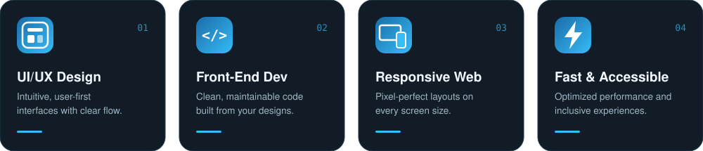
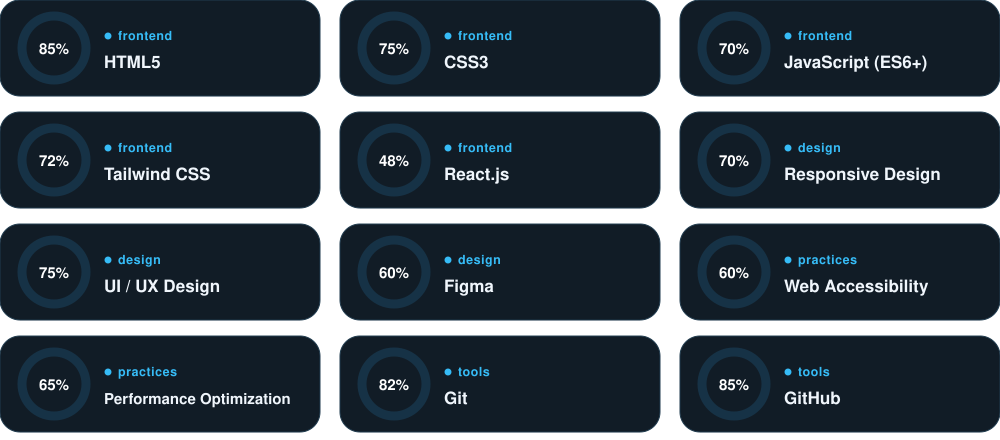
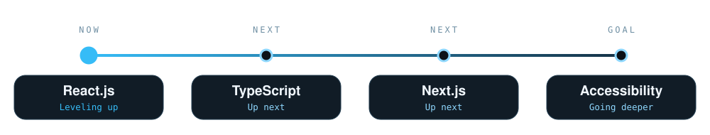

 

  

&nbsp;
&nbsp;

🔗 See my full work at <a href="https://mahmoud-dev.online/"><b>mahmoud-dev.online</b></a> · All my code in <a href="https://github.com/mahmoudxhub?tab=repositories"><b>Repositories</b></a>

  

